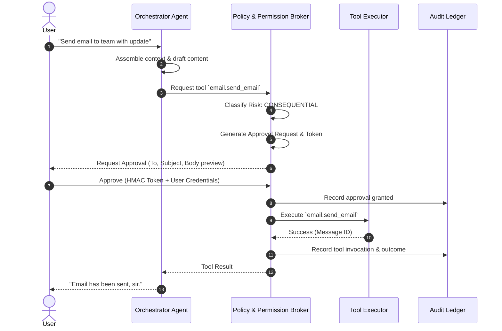

# JARVIS — Agent and Tool Boundaries

This document defines the specialized responsibilities, non-responsibilities, input/output schemas, and risk tiers for all sub-agents and tools across JARVIS.

---

## 1. Sub-Agent Matrix

| Agent Name | Core Responsibilities | Explicit Non-Responsibilities | Risk Tier |
|---|---|---|---|
| **Orchestrator Agent** | Intent analysis, context assembly, multi-agent dispatch, response synthesis, verification. | Direct execution of high-risk tools; bypassing permissions. | Safe / Moderate |
| **Memory Agent** | Fact extraction, category classification, conflict detection, semantic search, expiry maintenance. | Storing raw chat logs as memories without semantic filtering. | Safe / Moderate |
| **Task & Project Agent** | Task state transitions, blocker identification, dependency ordering, pending-work summaries. | Auto-marking tasks as complete without verification. | Safe / Moderate |
| **Routine & Temporal Agent** | RRULE evaluation, planned occurrence generation, confirmation logging, fasting/habit tracking. | Treating a planned routine as proof of past completion. | Safe |
| **Proactive Agent** | Meal check-in triggers, morning/evening briefing drafts, quiet hours enforcement. | Spamming repetitive notifications or unapproved interrupts. | Safe |
| **Research & Writing Agent** | Web search synthesis, citation attribution, document drafting, summarization. | Presenting web search results as verified system facts without citing source. | Safe |
| **Coding Agent** | Workspace inspection, code modifications, linting, unit test execution, diff presentation. | Modifying files outside the designated workspace; auto-committing or auto-deploying. | Consequential |
| **Browser Agent** | Web navigation, page inspection, screenshot generation, form preparation. | Submitting forms, financial checkouts, or credential submission without user approval. | Consequential |
| **Vision & Screen Agent** | Image analysis, OCR, visual document inspection, screen frame interpretation. | Persistent surveillance; saving raw video/image feeds without user request. | Moderate / Consequential |
| **Communication Agent** | Drafting emails and messages, preparing call briefings with transcription. | Sending emails, dispatching SMS, or initiating calls without approval token. | Consequential |
| **Commerce & Booking Agent** | Product comparison, cart preparation, price checks, booking summaries. | Authorizing payments or clicking final checkout without multi-factor user confirmation. | Consequential |

---

## 2. Tool Registry and Execution Boundaries

### 2.1 Safe Tools (Auto-Authorized for Authenticated Users)
* `time.get_current_time(timezone)`: Returns ISO timestamp in user timezone.
* `memory.search(query, limit)`: Returns relevant facts from `memories` table.
* `task.list_pending(project_id)`: Returns active tasks.
* `routine.get_last_confirmation(routine_name)`: Returns confirmed date of past occurrences.
* `web.search(query, max_results)`: Read-only search using configured provider.

### 2.2 Moderate Tools (Reversible State Modifications)
* `memory.create_fact(category, content, confidence)`: Inserts a new memory candidate.
* `task.create_task(title, due_at, project_id)`: Inserts a new task.
* `task.update_status(task_id, status)`: Transitions task state.
* `routine.confirm_occurrence(routine_id, date)`: Records user confirmation of routine completion.
* `document.create_draft(title, content, format)`: Creates a markdown/text artifact.

### 2.3 Consequential Tools (Strictly Require Cryptographic User Approval)
* `email.send_email(to, subject, body)`:
  * Intercepted by Policy Broker.
  * Creates `ApprovalRequest` with preview of `to`, `subject`, `body`.
  * Generates short-lived HMAC token.
  * Requires user to sign token via UI/Voice before execution.
* `system.execute_bash(command, cwd)`:
  * Restricted strictly to sandboxed workspace.
  * Full command string and target directory displayed in approval modal.
* `commerce.submit_order(merchant, total_amount, currency, item_summary)`:
  * Mandates explicit price verification and double confirmation.
* `device.activate_camera_stream()`:
  * Emits visible alert indicator and requires continuous user consent.

---

## 3. Strict Boundary Enforcement Architecture

