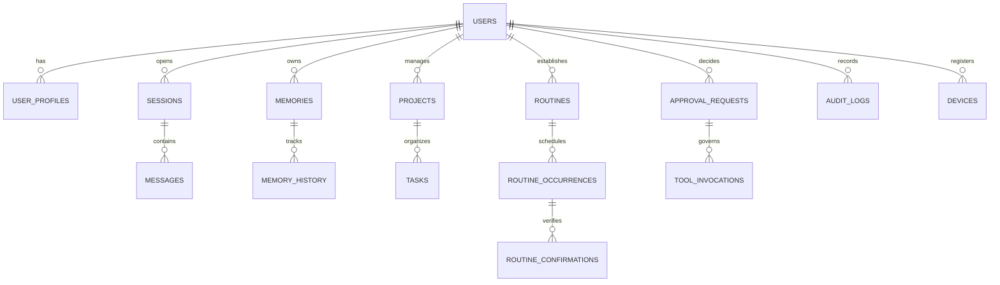

# JARVIS — Data Model Plan

This document defines the entity schemas, primary keys, relationships, indices, and data lifecycle rules adhering to Section 32 of `PRD.md`.

---

## 1. Entity-Relationship Overview

---

## 2. Core Relational Schemas

### 2.1 Identity & User Profiles
* **`users`**
  * `id`: UUID (PK)
  * `email`: VARCHAR(255) UNIQUE NOT NULL
  * `hashed_password`: VARCHAR(255) NOT NULL
  * `timezone`: VARCHAR(64) DEFAULT 'Asia/Kolkata' NOT NULL
  * `created_at`: TIMESTAMPTZ DEFAULT NOW() NOT NULL
  * `updated_at`: TIMESTAMPTZ DEFAULT NOW() NOT NULL

* **`user_profiles`**
  * `id`: UUID (PK)
  * `user_id`: UUID (FK -> users.id)
  * `display_name`: VARCHAR(128) NOT NULL
  * `preferred_address_form`: VARCHAR(64) DEFAULT 'sir'
  * `quiet_hours_start`: TIME DEFAULT '22:00:00'
  * `quiet_hours_end`: TIME DEFAULT '07:00:00'
  * `meal_check_in_enabled`: BOOLEAN DEFAULT TRUE
  * `voice_profile_id`: VARCHAR(64) DEFAULT 'eleven_labs_default_m'
  * `privacy_mode`: VARCHAR(32) DEFAULT 'standard'

### 2.2 Conversations & Messages
* **`sessions`**
  * `id`: UUID (PK)
  * `user_id`: UUID (FK -> users.id)
  * `title`: VARCHAR(255)
  * `status`: VARCHAR(32) DEFAULT 'active'  -- active, closed, archived
  * `created_at`: TIMESTAMPTZ DEFAULT NOW()
  * `updated_at`: TIMESTAMPTZ DEFAULT NOW()

* **`messages`**
  * `id`: UUID (PK)
  * `session_id`: UUID (FK -> sessions.id)
  * `sender_role`: VARCHAR(32) NOT NULL     -- user, assistant, system, tool
  * `content`: TEXT NOT NULL
  * `model_used`: VARCHAR(128)
  * `token_count`: INTEGER
  * `latency_ms`: INTEGER
  * `created_at`: TIMESTAMPTZ DEFAULT NOW()

### 2.3 Memory & Knowledge
* **`memories`**
  * `id`: UUID (PK)
  * `user_id`: UUID (FK -> users.id)
  * `category`: VARCHAR(64) NOT NULL       -- preference, biographical, habit, fact, project
  * `content`: TEXT NOT NULL
  * `confidence`: FLOAT DEFAULT 1.0 NOT NULL
  * `provenance`: VARCHAR(255) NOT NULL    -- conversation_id, manual_input, routine_confirmation
  * `sensitivity`: VARCHAR(32) DEFAULT 'standard' -- public, standard, private, secret
  * `expires_at`: TIMESTAMPTZ NULL
  * `is_active`: BOOLEAN DEFAULT TRUE
  * `created_at`: TIMESTAMPTZ DEFAULT NOW()
  * `updated_at`: TIMESTAMPTZ DEFAULT NOW()

### 2.4 Tasks & Projects
* **`projects`**
  * `id`: UUID (PK)
  * `user_id`: UUID (FK -> users.id)
  * `name`: VARCHAR(255) NOT NULL
  * `description`: TEXT
  * `status`: VARCHAR(32) DEFAULT 'active'  -- active, on_hold, completed, archived
  * `created_at`: TIMESTAMPTZ DEFAULT NOW()

* **`tasks`**
  * `id`: UUID (PK)
  * `project_id`: UUID NULL (FK -> projects.id)
  * `user_id`: UUID (FK -> users.id)
  * `title`: VARCHAR(255) NOT NULL
  * `description`: TEXT
  * `status`: VARCHAR(32) DEFAULT 'todo'    -- backlog, todo, in_progress, blocked, done, cancelled
  * `priority`: VARCHAR(16) DEFAULT 'medium'-- low, medium, high, urgent
  * `due_at`: TIMESTAMPTZ NULL
  * `completed_at`: TIMESTAMPTZ NULL
  * `created_at`: TIMESTAMPTZ DEFAULT NOW()
  * `updated_at`: TIMESTAMPTZ DEFAULT NOW()

### 2.5 Routines, Occurrences & Confirmations
* **`routines`**
  * `id`: UUID (PK)
  * `user_id`: UUID (FK -> users.id)
  * `title`: VARCHAR(255) NOT NULL          -- e.g. "Monday Fasting"
  * `recurrence_rule`: VARCHAR(255) NOT NULL-- e.g. "FREQ=WEEKLY;BYDAY=MO" (RFC 5545 RRULE)
  * `target_time`: TIME NULL                -- e.g. "09:00:00"
  * `is_active`: BOOLEAN DEFAULT TRUE
  * `created_at`: TIMESTAMPTZ DEFAULT NOW()

* **`routine_occurrences`**
  * `id`: UUID (PK)
  * `routine_id`: UUID (FK -> routines.id)
  * `scheduled_date`: DATE NOT NULL         -- e.g. 2026-10-19
  * `status`: VARCHAR(32) DEFAULT 'planned' -- planned, prompted, confirmed, missed, skipped
  * `prompted_at`: TIMESTAMPTZ NULL
  * `resolved_at`: TIMESTAMPTZ NULL

* **`routine_confirmations`**
  * `id`: UUID (PK)
  * `occurrence_id`: UUID (FK -> routine_occurrences.id)
  * `user_id`: UUID (FK -> users.id)
  * `confirmed_at`: TIMESTAMPTZ DEFAULT NOW() NOT NULL
  * `notes`: TEXT

### 2.6 Permissions, Approvals & Auditing
* **`approval_requests`**
  * `id`: UUID (PK)
  * `user_id`: UUID (FK -> users.id)
  * `session_id`: UUID NULL (FK -> sessions.id)
  * `tool_name`: VARCHAR(128) NOT NULL
  * `risk_tier`: VARCHAR(32) NOT NULL       -- safe, moderate, consequential
  * `proposed_arguments`: JSONB NOT NULL
  * `approval_token`: VARCHAR(255) UNIQUE NOT NULL
  * `status`: VARCHAR(32) DEFAULT 'pending' -- pending, granted, rejected, expired
  * `expires_at`: TIMESTAMPTZ NOT NULL
  * `created_at`: TIMESTAMPTZ DEFAULT NOW()
  * `decided_at`: TIMESTAMPTZ NULL

* **`audit_logs`**
  * `id`: UUID (PK)
  * `user_id`: UUID (FK -> users.id)
  * `event_type`: VARCHAR(128) NOT NULL
  * `actor`: VARCHAR(64) NOT NULL           -- user, orchestrator, agent:<name>
  * `details`: JSONB NOT NULL
  * `ip_address`: VARCHAR(45)
  * `created_at`: TIMESTAMPTZ DEFAULT NOW() NOT NULL

---

## 3. Database Indexes & Performance Rules
1. Composite index `(user_id, status)` on `tasks` and `projects` for instant pending-work queries.
2. Composite index `(routine_id, scheduled_date)` on `routine_occurrences` for idempotency and fast date checks.
3. Index on `approval_token` and `(user_id, status)` on `approval_requests`.
4. Append-only enforcement on `audit_logs` table (no `UPDATE` or `DELETE` grants).
