# JARVIS — Phased Implementation Roadmap

This roadmap defines the dependency-ordered, incrementally verifiable development lifecycle for JARVIS. Implementation strictly advances one phase at a time following explicit user approval.

---

## Roadmap Overview

```mermaid
graph TD
    P0[Phase 0: PRD & Architecture Validation] --> P1[Phase 1: Project Foundation]
    P1 --> P2[Phase 2: Security & Permissions]
    P2 --> P3[Phase 3: Time & Temporal Engine]
    P3 --> P4[Phase 4: Data & Memory Layer]
    P4 --> P5[Phase 5: Tasks & Projects]
    P5 --> P6[Phase 6: Events & Routines]
    P6 --> P7[Phase 7: Conversation Orchestration]
    P7 --> P8[Phase 8: Proactive Intelligence]
    P8 --> P9[Phase 9: NVIDIA Model Integration]
    P9 --> P10[Phase 10: ElevenLabs Voice Integration]
    P10 --> P11[Phase 11: Core Holographic UI]
    P11 --> P12[Phase 12: Research & Writing Agents]
    P12 --> P13[Phase 13: Coding Agent]
    P13 --> P14[Phase 14: Browser & Computer Agent]
    P14 --> P15[Phase 15: Multimodal & Vision]
    P15 --> P16[Phase 16: Business Agents]
    P16 --> P17[Phase 17: Communication & Calls]
    P17 --> P18[Phase 18: Shopping & External Actions]
    P18 --> P19[Phase 19: Background Scheduling & Jobs]
    P19 --> P20[Phase 20: Cross-Device Ecosystem]
    P20 --> P21[Phase 21: Production Hardening]
```

---

## Detailed Phase Specifications

### Phase 0: PRD, Repository, and Architecture Validation
* **Objective:** Establish verified technical boundaries, risk registers, and system designs before writing runtime code.
* **Scope:** Repository inspection, architectural blueprinting, dependency mapping, risk register, and open-question cataloging.
* **Deliverables:** Complete `docs/` architecture documents, phase definitions.
* **Success Criteria:** All architecture artifacts approved by the user.

### Phase 1: Project Foundation
* **Objective:** Create the core backend runtime, configuration management, environment validation, database connectivity, and health monitoring.
* **Scope:** FastAPI application factory, Pydantic settings, PostgreSQL engine + Alembic migration harness, health endpoints (`/healthz`, `/readyz`), structured JSON logger, and CI lint/test scripts.
* **Deliverables:** Runnable backend server, database health tests, test suite foundation.

### Phase 2: Security & Permission Foundation
* **Objective:** Implement tenant data isolation, capability tokens, tool risk classification, and audit logging.
* **Scope:** Role/Scope definitions, Risk Classifier (`SAFE`, `MODERATE`, `CONSEQUENTIAL`), Approval Request entity and token verification, tamper-evident audit log ledger.
* **Deliverables:** Policy & Permission Broker module, unit tests for unauthorized tool interception.

### Phase 3: Time & Temporal Foundation
* **Objective:** Provide a deterministic temporal engine for relative date parsing and Asia/Kolkata timezone mapping.
* **Scope:** Timezone converter (UTC storage <-> Asia/Kolkata display), relative date resolver ("today", "yesterday", "next Monday", "2 PM"), ISO timestamp validations.
* **Deliverables:** Temporal service module with comprehensive edge-case date tests.

### Phase 4: Data & Memory Foundation
* **Objective:** Build declarative long-term memory with provenance, confidence scores, sensitivity classifications, and vector search.
* **Scope:** `memories` table schema, memory extractor interface, memory operations (`save_memory`, `forget_memory`, `correct_memory`), semantic retrieval with user-scoped isolation.
* **Deliverables:** Memory agent service, database migration, memory lifecycle test suite.

### Phase 5: Tasks & Projects
* **Objective:** Reliable pending-work tracking with status transitions, blockers, and continuity across sessions.
* **Scope:** `projects` and `tasks` schemas, status state machine (`BACKLOG`, `TODO`, `IN_PROGRESS`, `BLOCKED`, `DONE`), completion verification rules, pending-work queries.
* **Deliverables:** Task management engine and API endpoints.

### Phase 6: Events & Routines
* **Objective:** Implement distinction between recurring routines, planned occurrences, and confirmed completed events.
* **Scope:** `routines` and `routine_occurrences` schemas, recurrence engine (e.g. "Every Monday I fast"), confirmation recording ("I fasted today"), history queries ("When was my last fasting?").
* **Deliverables:** Habit/Routine engine ensuring planned dates are never reported as completed without user confirmation.

### Phase 7: Conversation Orchestration
* **Objective:** Coordinate multi-turn context assembly, relevant memory injection, task injection, and deterministic response generation.
* **Scope:** Conversation session manager, context window budgeting, prompt formatting, clarification loop when intent is ambiguous.
* **Deliverables:** Orchestrator service with end-to-end conversation tests.

### Phase 8: Human-Like Proactive Behavior
* **Objective:** Configurable, non-intrusive proactive interactions adhering to quiet hours and habit schedules.
* **Scope:** Proactive rule evaluator (e.g. 2 PM meal check-in, routine reminders), anti-nagging throttle, natural forms of address (configurable "sir").
* **Deliverables:** Proactive intelligence engine and notification dispatcher.

### Phase 9: NVIDIA Model Integration
* **Objective:** Connect the orchestrator to live NVIDIA NIM APIs with model routing, retries, and fallbacks.
* **Scope:** NVIDIA API client adapter, model router (`fast_chat`, `reasoning`, `coding`, `vision`), token usage tracking, structured JSON response enforcement.
* **Deliverables:** Live LLM integration with mock provider fallback for local testing.

### Phase 10: ElevenLabs Voice Integration
* **Objective:** Integrate realistic speech synthesis with voice profiles and private voice modes.
* **Scope:** ElevenLabs API adapter, voice profiles (Indian English, Hindi, Telugu, neutral English), speed/stability parameters, audio streaming endpoints.
* **Deliverables:** TTS service module and voice configuration API.

### Phase 11: Core Holographic User Interface
* **Objective:** Create the futuristic 2D Web UI featuring the holographic theme, orbital animations, and operational panels.
* **Scope:** Vite + React frontend, glowing core visualizer, Web Audio waveform monitor, conversation feed, approval modal, and settings drawer.
* **Deliverables:** Responsive holographic web client connected via REST and WebSockets.

### Phase 12: Research & Writing Agents
* **Objective:** Enable multi-source web research, fact synthesis, citation tracking, and structured document drafting.
* **Scope:** Web search tool integration, source validator, document generation pipeline with exportable markdown/PDF artifacts.

### Phase 13: Coding Agent
* **Objective:** Safe codebase inspection, planned code refactoring, test execution, and diff generation with mandatory approval.
* **Scope:** Sandboxed execution runner, git diff viewer, change proposal review flow.

### Phase 14: Browser & Computer Agent
* **Objective:** Headless browser automation for structured web interaction with screenshot review.
* **Scope:** Browser tool provider, action sandbox, visual screenshot logger, form submission approval gates.

### Phase 15: Vision, Camera, & Screen
* **Objective:** Multimodal image and screen inspection with explicit user permissions and visual indicators.
* **Scope:** Image upload handler, screen share frame extractor, camera privacy toggles, multimodal NVIDIA NIM vision routing.

### Phase 16: Business & Productivity Agents
* **Objective:** Automated lead research, competitor monitoring, and business report drafting with strict separation of personal and business contexts.

### Phase 17: Communication & Calls
* **Objective:** Email and messaging drafting with human-in-the-loop review; telephony call briefing stubs with recording consent warnings.

### Phase 18: Shopping, Booking, & External Actions
* **Objective:** E-commerce research, order preparation, double-confirmation cart summaries, and idempotent purchase triggers.

### Phase 19: Background Scheduling & Jobs
* **Objective:** Render Cron integration, daily morning and evening briefings, routine scheduler ticks, and memory consolidation.

### Phase 20: Cross-Device & Advanced UI
* **Objective:** Device registry, context handoff between mobile and desktop, multi-screen display modes.

### Phase 21: Production Hardening
* **Objective:** Security penetration testing, rate limit hardening, load testing, disaster recovery drills, and Render deployment verification.
